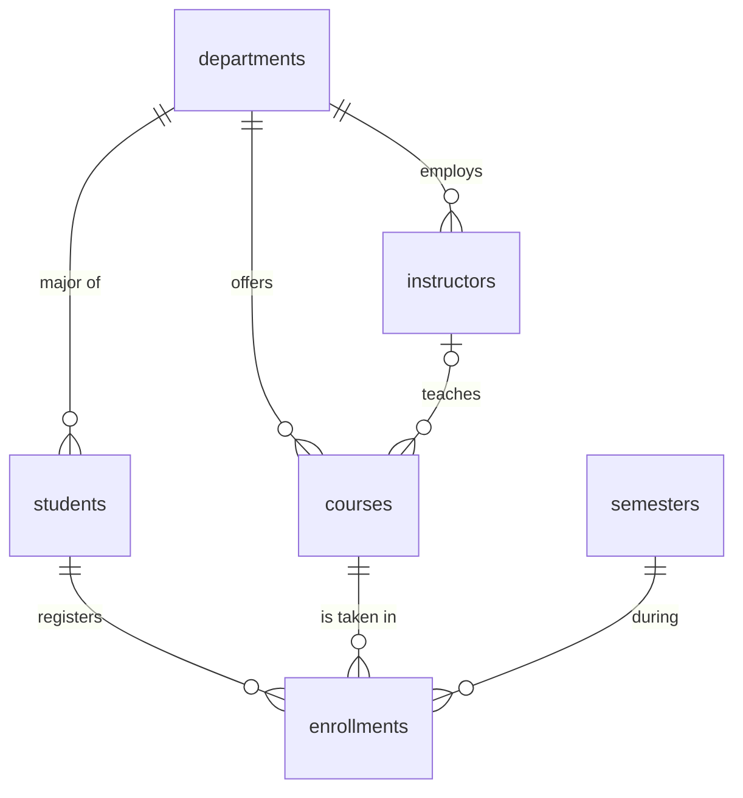

# Homework 04 - University Course Registration System (INS3064)

- **Name:** Do Thuy Linh
- **Student ID:** 24071506
- **Course:** INS3064
- **Demo video:** <paste your unlisted YouTube link here>

## Overview

This assignment designs and builds a relational database for a **university course registration system** using MySQL. The whole database is created from a single script, `university_db.sql`, which creates the database, 6 tables with constraints, and realistic sample data with Vietnamese names.

## Project Structure

```
.
├── university_db.sql   # Creates the database, tables, and sample data
└── README.md
```

## Entity-Relationship Diagram



## Tables

| Table | Description | Foreign Keys |
|-------|-------------|--------------|
| `departments` | Academic departments | - |
| `semesters` | Semesters (e.g. Fall 2024) | - |
| `instructors` | Instructors | `department_id` |
| `students` | Students | `department_id` |
| `courses` | Courses | `department_id`, `instructor_id` |
| `enrollments` | Junction table (M:N) linking students to courses per semester, with an optional grade | `student_id`, `course_id`, `semester_id` |

## Key Design Decisions

- **Primary keys** use `AUTO_INCREMENT` on every table.
- **`UNIQUE`** is applied to fields that must not repeat: `email`, `student_code`, `course_code`, department name and code, and semester name.
- **`UNIQUE (student_id, course_id, semester_id)`** on `enrollments` prevents a student from registering for the same course twice in the same semester.
- **`DECIMAL(3,2)`** is used for GPA and grades because it stores exact two-decimal values, unlike `FLOAT`.
- **`ENUM`** is used for `gender` and `grade_letter` to restrict values to a fixed valid set at the database level.
- **`CHECK` constraints:** GPA and grade between 0.00 and 4.00, credits between 1 and 6, and semester end date after start date.
- **Foreign key actions:**
  - `RESTRICT`: a department, course, or semester cannot be deleted while it is still referenced.
  - `CASCADE`: deleting a student also deletes their enrollments.
  - `SET NULL`: deleting an instructor leaves their courses unassigned.
- Naming follows `snake_case` and avoids MySQL reserved words.
- The script is **idempotent**: it uses `DROP DATABASE IF EXISTS` and `DROP TABLE IF EXISTS`, so it can be re-run without errors.

## Sample Data

| Table | Records |
|-------|---------|
| `departments` | 5 |
| `semesters` | 5 |
| `instructors` | 6 |
| `students` | 8 |
| `courses` | 7 |
| `enrollments` | 14 |

## How to Run

**Requirements:** MySQL 8.0.16 or later (so `CHECK` constraints are enforced) with the InnoDB engine.

### Option 1: phpMyAdmin

1. Open phpMyAdmin (e.g. via XAMPP): `http://localhost/phpmyadmin`.
2. Go to the **SQL** tab.
3. Paste the full contents of `university_db.sql` and click **Go**.
4. Refresh the left sidebar and select the `university_db` database.

### Option 2: Command line

```bash
mysql -u root -p < university_db.sql
```

### Sample verification query

```sql
USE university_db;

SELECT s.full_name, c.title, sem.name AS semester, e.grade
FROM enrollments e
JOIN students  s   ON s.id   = e.student_id
JOIN courses   c   ON c.id   = e.course_id
JOIN semesters sem ON sem.id = e.semester_id
ORDER BY s.full_name, sem.start_date;
```
